# Laymate

[中文](README.md) | **English**

Tell your AI assistant what you want to write, provide a topic or reference link, and choose a template. Get a complete, formatted article as an HTML file, ready to copy into the WeChat Official Accounts editor.

**There are currently 59 templates, with more on the way.** If you find this useful, please give the project a **Star ⭐** to support continued improvements.

Works with skill-enabled AI assistants that can run local commands, such as Claude Code, Codex, and Cursor.

## Installation

**Option 1: npm (recommended)**

Requires **Node.js 20 or later**. Run:

```bash
npx laymate-skill@latest
```

The installer copies the skill into `~/.agents/skills`, the cross-agent directory read natively by Codex, Cursor, Gemini CLI, VS Code, ZCode, and other agents; when Claude Code is detected, an extra copy goes into `~/.claude/skills` (it does not read the standard directory). Run the same command again to update; uninstall with `npx laymate-skill uninstall`. Use `--dir` for a custom directory, and `--claude` / `--no-claude` to force or skip the Claude Code copy.

**Option 2: ask your AI assistant**

Copy this prompt and send it to your AI assistant:

```text
Install the skill from https://github.com/wwnetboy/laymate-skill into your skills directory.
```

To update, ask it to update laymate from the same repository.

<details>
<summary>Manual installation</summary>

Download the [repository ZIP](https://github.com/wwnetboy/laymate-skill/archive/refs/heads/main.zip), create a `laymate` folder in your assistant's skills directory, and copy the repository-root `SKILL.md`, `agents`, `assets`, `references`, and `scripts` into it:

| AI assistant | Personal skills directory |
| --- | --- |
| Codex, Cursor, Gemini CLI, VS Code, ZCode, etc. | `~/.agents/skills/` (cross-agent) |
| [Claude Code](https://code.claude.com/docs/en/skills#choose-where-skills-load) | `~/.claude/skills/` |

Follow the documentation for other clients. Copy all Skill files; reopen the client if the skill does not appear.

</details>

## Usage

Give the assistant a topic or reference link. You can also specify the template, audience, length, and writing style.

**Example 1: Write with a specific template**

```text
Use laymate with emerald-prologue to write a WeChat article about AI coding.
```

**Example 2: Write an article from a topic**

```text
Use laymate to write a WeChat article about time management.
```

**Example 3: Ask without naming the skill**

```text
Write a WeChat article about AI coding.
```

Install this skill first and use an assistant that supports automatic skill selection. If it is not selected, include the skill name.

If you do not specify a template, the assistant can recommend styles and help you choose. You can also generate the article with emerald-prologue first and switch templates in the page afterward.

You can also provide an existing draft for editing or formatting. Code is highlighted automatically; images can use their original appearance, rounded corners with a shadow, or a Mac-window frame.

### Publish to WeChat

1. Open the generated HTML, review the layout, and choose a template.
2. Click “复制标题” (copy title) and “一键复制正文” (copy body), then paste into the matching WeChat editor fields.
3. Preview in WeChat and publish when the result looks right.

If an image does not paste with the text, save it using the links at the bottom of the page and upload it to WeChat. Page controls and supporting references are currently in Chinese.

## Template previews

Here are some of the available styles. Click an image to enlarge it, or see the [full template catalog](references/template-catalog.md).

<table>
  <tr>
    <td width="33%" align="center"><b>Emerald Prologue</b><br><sub>emerald-prologue</sub></td>
    <td width="33%" align="center"><b>Sakura Grain</b><br><sub>sakura-grain</sub></td>
    <td width="33%" align="center"><b>Lilac Diamond</b><br><sub>lilac-diamond</sub></td>
  </tr>
  <tr>
    <td width="33%" align="center" valign="top"><a href="assets/previews/emerald-prologue.png">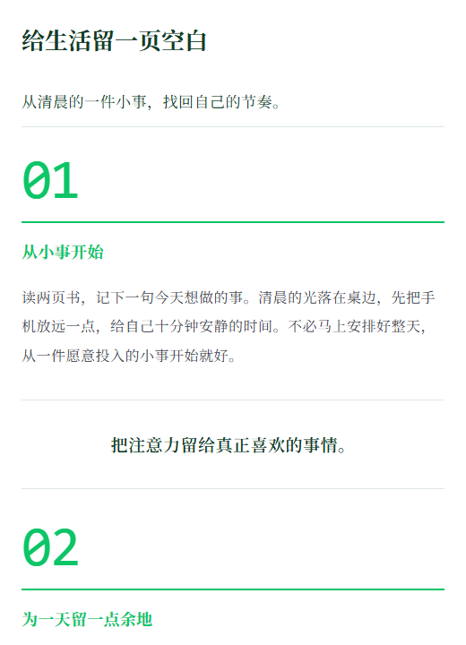</a></td>
    <td width="33%" align="center" valign="top"><a href="assets/previews/sakura-grain.png">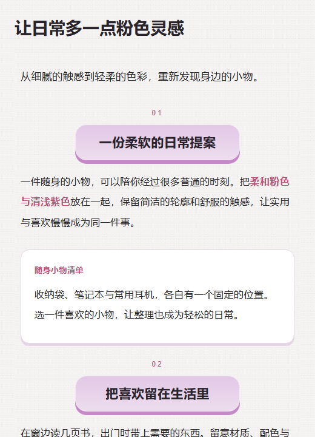</a></td>
    <td width="33%" align="center" valign="top"><a href="assets/previews/lilac-diamond.png">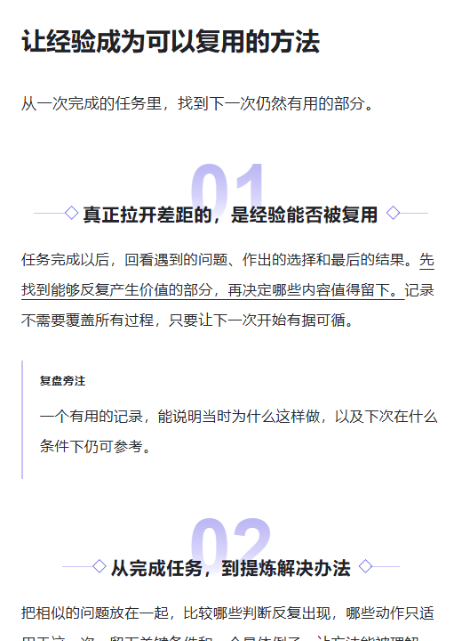</a></td>
  </tr>
  <tr>
    <td width="33%" align="center"><b>Apricot Bulletin</b><br><sub>apricot-bulletin</sub></td>
    <td width="33%" align="center"><b>Blue-Green Guide</b><br><sub>blue-green-guide</sub></td>
    <td width="33%" align="center"><b>Hand-drawn Blue</b><br><sub>handdrawn-blue</sub></td>
  </tr>
  <tr>
    <td width="33%" align="center" valign="top"><a href="assets/previews/apricot-bulletin.png">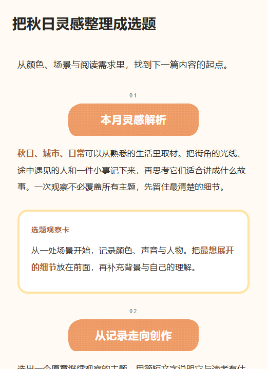</a></td>
    <td width="33%" align="center" valign="top"><a href="assets/previews/blue-green-guide.png">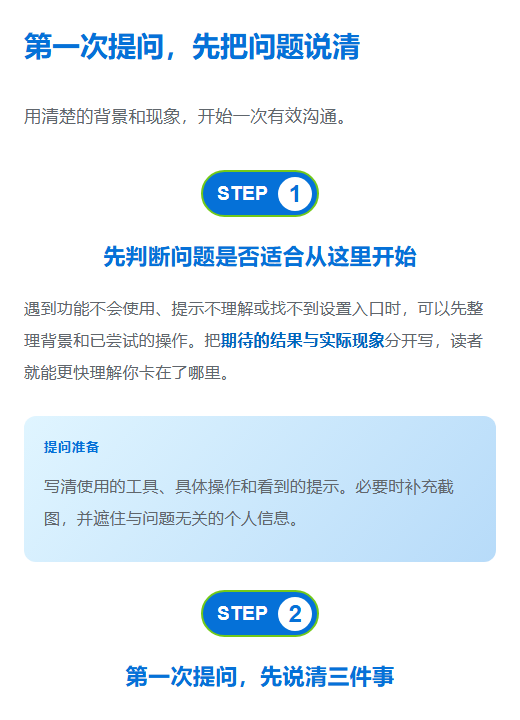</a></td>
    <td width="33%" align="center" valign="top"><a href="assets/previews/handdrawn-blue.png">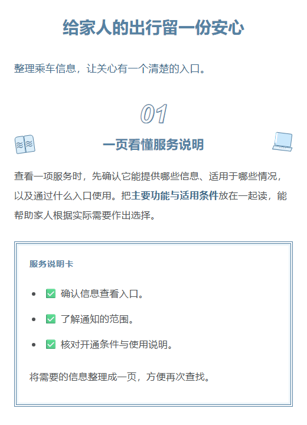</a></td>
  </tr>
  <tr>
    <td width="33%" align="center"><b>Sky Grid</b><br><sub>sky-grid</sub></td>
    <td width="33%" align="center"><b>Blue-Bar Brief</b><br><sub>blue-bar-brief</sub></td>
    <td width="33%" align="center"><b>Green Flight</b><br><sub>green-flight</sub></td>
  </tr>
  <tr>
    <td width="33%" align="center" valign="top"><a href="assets/previews/sky-grid.png">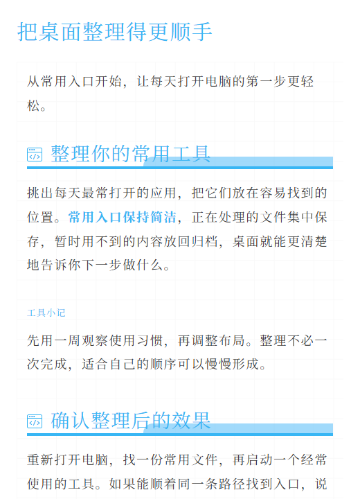</a></td>
    <td width="33%" align="center" valign="top"><a href="assets/previews/blue-bar-brief.png">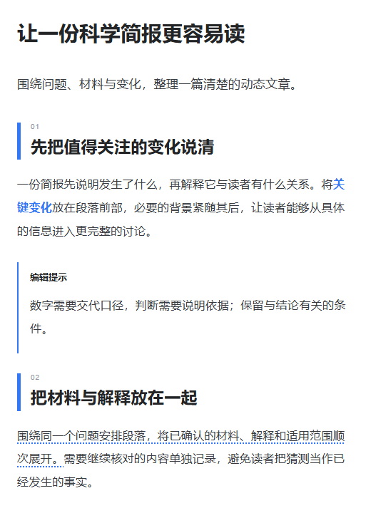</a></td>
    <td width="33%" align="center" valign="top"><a href="assets/previews/green-flight.png">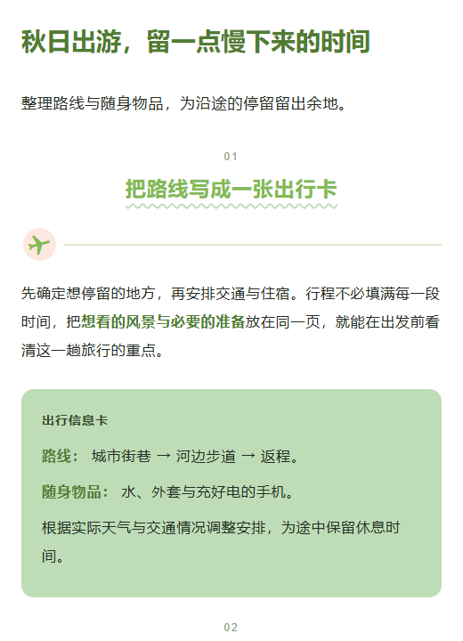</a></td>
  </tr>
  <tr>
    <td width="33%" align="center"><b>Obsidian Editorial</b><br><sub>obsidian-editorial</sub></td>
    <td width="33%" align="center"><b>Cinnabar Folio</b><br><sub>cinnabar-folio</sub></td>
    <td width="33%" align="center"><b>City Newspaper</b><br><sub>city-newspaper</sub></td>
  </tr>
  <tr>
    <td width="33%" align="center" valign="top"><a href="assets/previews/obsidian-editorial.png">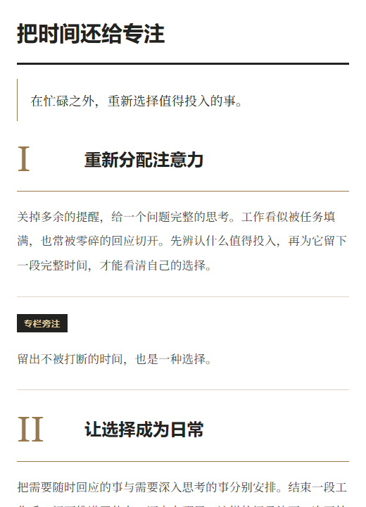</a></td>
    <td width="33%" align="center" valign="top"><a href="assets/previews/cinnabar-folio.png">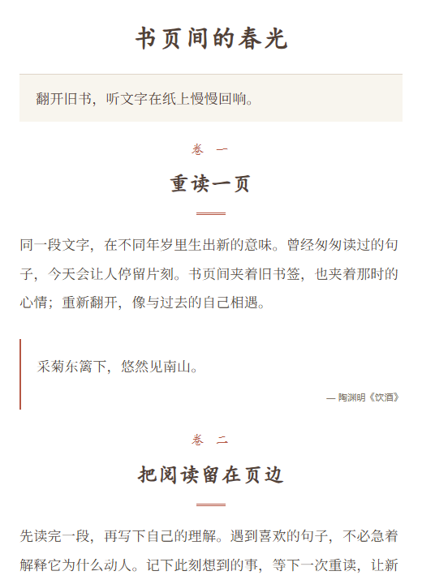</a></td>
    <td width="33%" align="center" valign="top"><a href="assets/previews/city-newspaper.png">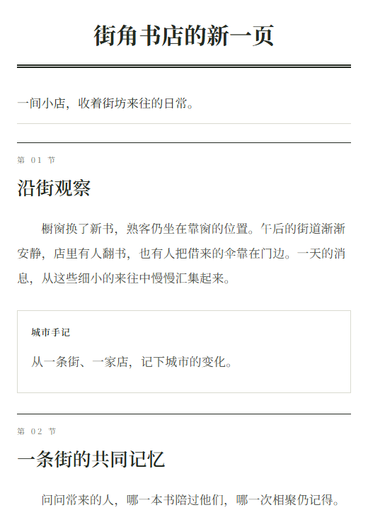</a></td>
  </tr>
  <tr>
    <td width="33%" align="center"><b>Cream Letter</b><br><sub>cream-letter</sub></td>
    <td width="33%" align="center"><b>Travel Ticket</b><br><sub>travel-ticket</sub></td>
    <td width="33%" align="center"><b>Swiss Grid</b><br><sub>swiss-grid</sub></td>
  </tr>
  <tr>
    <td width="33%" align="center" valign="top"><a href="assets/previews/cream-letter.png">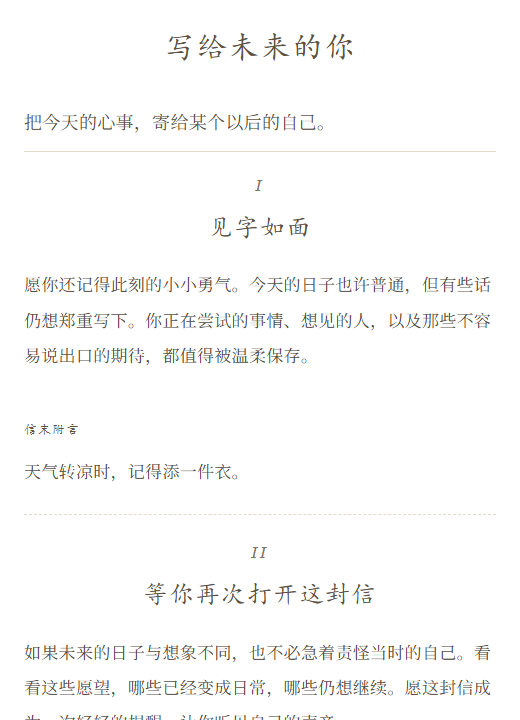</a></td>
    <td width="33%" align="center" valign="top"><a href="assets/previews/travel-ticket.png">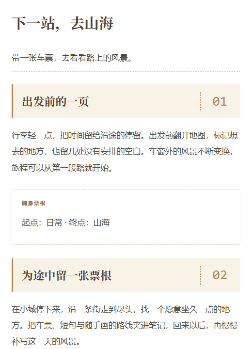</a></td>
    <td width="33%" align="center" valign="top"><a href="assets/previews/swiss-grid.png">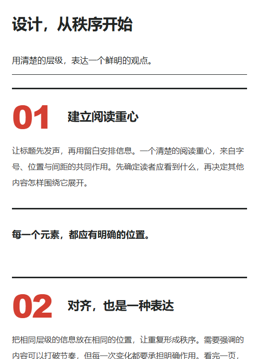</a></td>
  </tr>
  <tr>
    <td width="33%" align="center"><b>Terminal Lab</b><br><sub>terminal-lab</sub></td>
    <td width="33%" align="center"><b>Engineering Blueprint</b><br><sub>engineering-blueprint</sub></td>
    <td width="33%" align="center"><b>Midnight Screen</b><br><sub>midnight-screen</sub></td>
  </tr>
  <tr>
    <td width="33%" align="center" valign="top"><a href="assets/previews/terminal-lab.png">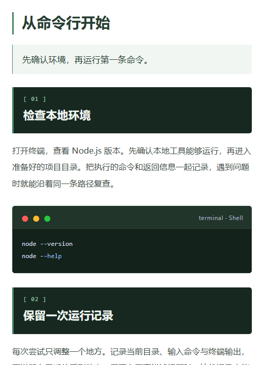</a></td>
    <td width="33%" align="center" valign="top"><a href="assets/previews/engineering-blueprint.png">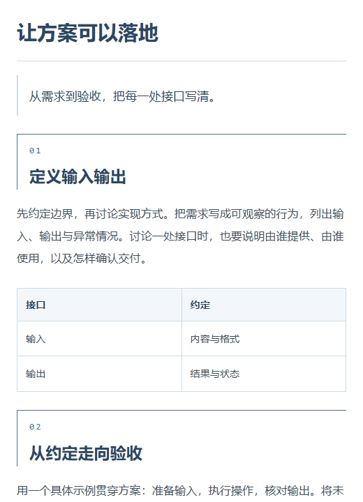</a></td>
    <td width="33%" align="center" valign="top"><a href="assets/previews/midnight-screen.png">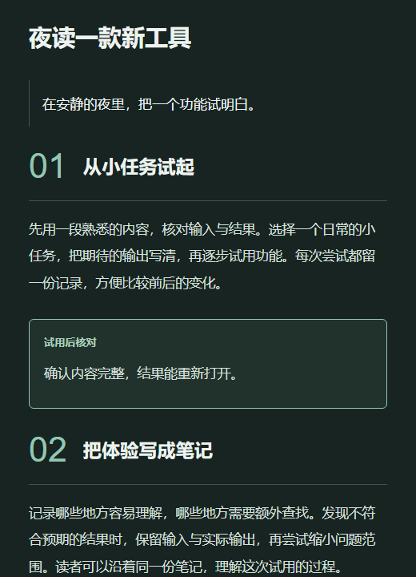</a></td>
  </tr>
</table>

<details>
<summary>Already have Markdown? Render it directly</summary>

Download the repository and run this command from its root. Replace `article.md` with your article file, then open the generated `article.html`.

```bash
node scripts/render-article.mjs --input article.md --output article.html --template emerald-prologue
```

See the [component reference](references/components.md) for callouts, steps, tables, and more.

</details>

## Updates and feedback

We will keep adding templates and improving formatting and WeChat copying. Please [Star the project](https://github.com/wwnetboy/laymate-skill) if it helps you, and share template ideas or problems through [Issues](https://github.com/wwnetboy/laymate-skill/issues).

## License

This project uses the [MIT License](LICENSE). Personal and commercial use, modification, further development, and redistribution are allowed. Keep the copyright and license notices when redistributing. The project is provided as is, without warranty.

Third-party libraries retain their own licenses: [Marked (MIT)](scripts/vendor/LICENSE) and [highlight.js (BSD-3-Clause)](scripts/vendor/highlight/LICENSE).
